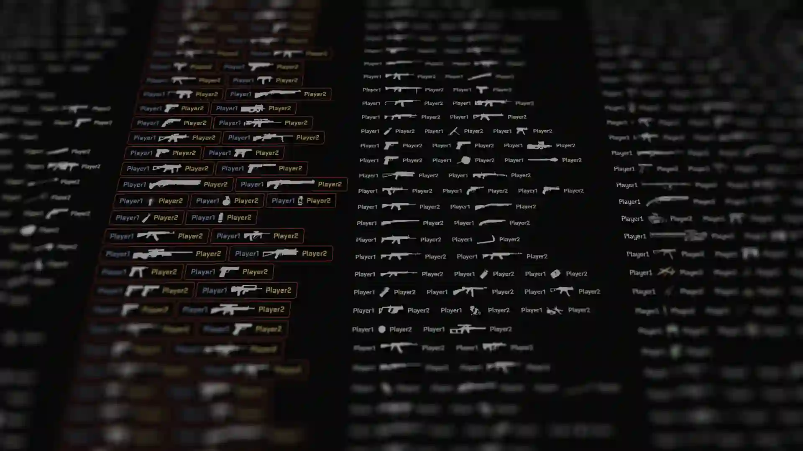

<p align="center">
  
</p>

<h1 align="center">KillFeed Generator</h1>

<p align="center">
  Create death notice overlays and killfeeds for <strong>Rust</strong>, <strong>PUBG</strong>,
  <strong>CS2</strong> and <strong>COD MW3</strong> directly in the browser.
  Customize names, icons, colors and layout, then export a transparent PNG for your edit.
</p>

## Features

- Four game templates with the original weapon icons.
- Live video and photo previews while you edit.
- Player names, headshot and extra icons per kill.
- Font family, size, weight, colors, padding, spacing, border and position controls.
- Custom font loading from a URL.
- Combined "All Content" export for a full killfeed.
- High-resolution PNG download with a transparent background.
- Responsive layout with a dedicated Customize popup on desktop and mobile.
- Shareable setups through URL parameters, saved from the Customize popup.

## Supported games

| Game | Generator page | Style tokens |
| --- | --- | --- |
| Rust | `killfeed-generator-rust.html` | `assets/css/params_rust.css` |
| PUBG | `killfeed-generator-pubg.html` | `assets/css/params_pubg.css` |
| CS2 | `killfeed-generator-cs2.html` | `assets/css/params_cs2.css` |
| COD MW3 | `killfeed-generator-codmw3.html` | `assets/css/params_codmw3.css` |

The Rust package also includes the editable Photoshop template
`assets/psd/rust_death_notice.psd`.

## Getting started

The pages load templates and game data with XHR, so they must be served over HTTP.
Opening the HTML files directly with `file://` will not work.

### Windows

Run `start.bat`. It checks for PHP 8.4, downloads a portable copy into
`dependencies/php` when needed, starts a local server and opens:

```
http://127.0.0.1:8000/
```

### Any static server

The site is plain HTML, CSS, JavaScript and JSON. From the project root:

```bash
python -m http.server 8000
```

Then open `http://127.0.0.1:8000/index.html`.

## How to use

1. Open a game generator from the home page.
2. Pick a weapon in the generator.
3. Use the video and photo preview tabs to check the overlay in context.
4. Open **Customize** to edit names, icons, typography, colors and item style.
5. Press **Save** to apply the changes and write the current setup to the URL.
6. Go to **Export**, then download the generated PNG.

## Project structure

```
.
├── index.html                     Home page and generator listing
├── 404.html                       Not-found page
├── killfeed-generator-*.html      Game generator pages
├── assets/
│   ├── css/
│   │   ├── params_global.css      Shared design tokens
│   │   ├── params_*.css           Per-game color themes
│   │   ├── studio.css             Studio, modal and export UI
│   │   └── style.css              Base layout and components
│   ├── js/
│   │   ├── script.js              Generator, settings and export logic
│   │   ├── studio-ui.js           Customize popup, previews and drawers
│   │   ├── screenshot-preview.js  Canvas rendering
│   │   ├── gameplay-player.js     Video preview
│   │   ├── aside-carousel.js      Infinite aside cards
│   │   └── pages-listing.js       Home page cards
│   ├── json/
│   │   ├── killfeed-*-params.json Game data, weapons and options
│   │   ├── pages.json             Home page card data
│   │   └── fonts.json             Bundled font list
│   ├── tpl/options.tpl            Customizer markup template
│   ├── img/                       Banners, icons and backgrounds
│   ├── font/                      Bundled fonts
│   └── psd/                       Rust PSD template
├── start.bat                      Windows development server
└── dependencies/                  Portable PHP installed by start.bat
```

## Customizing a game

- **Colors and theme:** edit `assets/css/params_<game>.css`.
- **Weapons, player defaults, additional icons and option groups:**
  edit `assets/json/killfeed-<game>-params.json`.
- **Additional icon order and spacing:** each entry in `settings.additionals`
  uses `{ "order": "prefix" | "suffix", "margin": "..." }`. `order` places the
  icon before or after the weapon. `margin` is optional and accepts any CSS
  margin shorthand; CS2 uses it to pull the `Fly` icon over the weapon.
- **Home page cards:** edit `assets/json/pages.json`.
- **Customizer markup:** edit `assets/tpl/options.tpl`.

Example:

```json
"Fly": {
  "order": "prefix",
  "margin": "calc(var(--kg-icon-size-selected) * -1 / 1.3) calc(var(--kg-icon-size-selected) * -1 / 2) 0 0"
}
```

## Notes

- `studio.css` and the shared Studio scripts are used by all four generator pages.
- Export images are generated as PNG with a transparent background.
- URL parameters cover player names, the selected weapon, style fields and
  additional-icon toggles, so a saved link restores the setup.

---

© Striker Production. All rights reserved.
